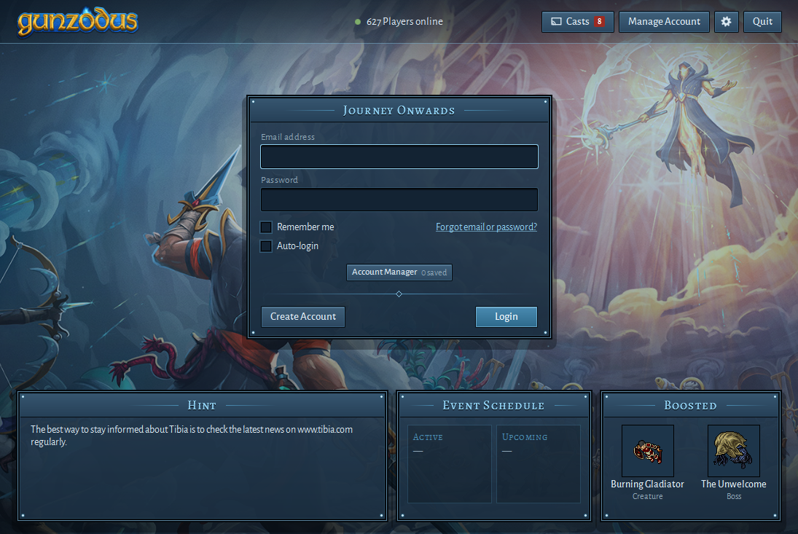
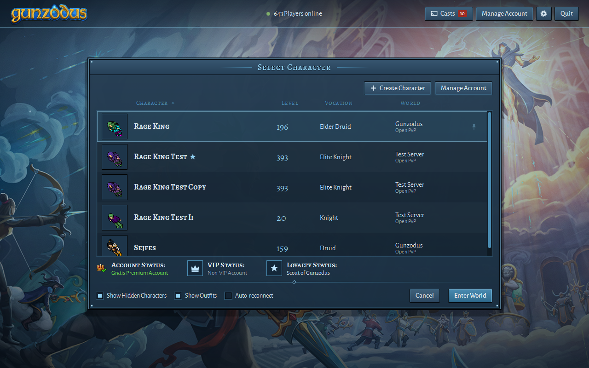
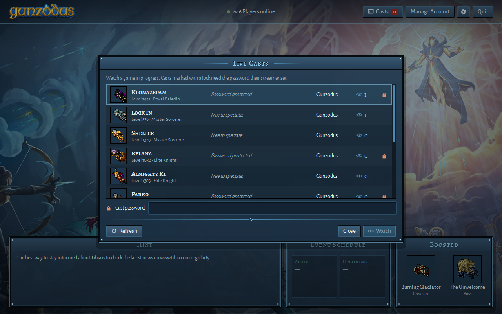

# GTC — a new client for GunzOT projects, built from scratch

**GTC** is a completely new game client for GunzOT projects, written from the ground up in **modern C++20** and
**Qt 6 Quick**. It is not a fork of OTClient and contains no code from it or from the official client. Every
system, from the network layer and protocol decoder to the map renderer and the user interface, is GTC's own.

The goal is a **high-performance client for GunzOT** that implements every game module and adds the
quality-of-life features players expect, all on a modern, lean and fast engine.

> **Alpha.** GTC is in active development. The game is fully playable, but expect bugs and missing details.
> Builds are published on the [Releases](https://github.com/gunzino/GTC-public/releases) page.
> Please report problems in [Issues](https://github.com/gunzino/GTC-public/issues).

<table>
  <tr>
    <td width="33%"></td>
    <td width="33%"></td>
    <td width="33%"></td>
  </tr>
  <tr>
    <td align="center">Login screen</td>
    <td align="center">Character list</td>
    <td align="center">Live casts</td>
  </tr>
</table>

Click a picture to open it full size.

---

## Why a new client?

OTClient-based clients (OTC, OTCv8, Mehah and their forks) are built on an engine from the early 2010s, with most
of the interface and game logic written in Lua scripts. They are flexible, but they also carry that age with them:
high memory use, single-threaded asset loading, an old rendering backend, and modern Tibia features that are
missing, partly implemented or behave differently from the original.

GTC starts over with today's tools.

| | OTC-based clients | GTC |
|---|---|---|
| **Language** | C++ engine with most of the UI and logic in Lua scripts | C++20 throughout; the UI is declarative QML backed by compiled C++ |
| **Rendering** | OpenGL / DirectX 9 (via ANGLE) | Qt scene graph: **Direct3D 11, Direct3D 12, Vulkan or OpenGL**, your choice |
| **Memory use** | Can peak above 4 GB | **600–700 MB**, stable (see below) |
| **Asset loading** | Loaded on the main thread | Sprite sheets decoded on **worker threads**, never blocking a frame; unused textures are freed |
| **Modern features** | Missing or partial, often server-specific | Built to match the original client, screen by screen |
| **Protocol errors** | A malformed packet can crash the client or drop the connection | Every read is bounds-checked; a bad message is skipped, the session keeps running |
| **Quality checks** | Mostly manual | Around 290 automated test suites, plus side-by-side checks against the original client |

### Lower RAM usage

| | OTC-based client (GunzOTC) | GTC |
|---|---|---|
| RAM in game, with HD sprites | peaks at **more than 4 GB** | **600–700 MB**, stable |

GTC keeps memory use low by design: no scripting VM holding the whole interface, sprite sheets decoded on demand
and released when no longer used, and compact game-state stores in plain C++. Memory stays flat over long play
sessions instead of growing.

### Other advantages

- **Smooth frame pacing.** Movement, animation and drawing are all evaluated for the same moment in each frame, as
  the original client does, so walking looks smooth at any frame rate. V-Sync, a frame limiter and a separate frame
  rate for an unfocused window are built in.
- **Reliable walking at high ping.** Client-side prediction with server reconciliation; with a high ping the client
  plans steps ahead, so walking stays fluid.
- **Multi-path connection.** The game runs over more than one network path, so one bad route doesn't cost you
  the session.
- **Faithful behaviour.** Game rules, timings and texts follow a written specification of the original client, and
  each feature is checked against the original before it ships.
- **Your installation stays untouched.** GTC keeps its settings in its own folder and never writes to a Tibia
  installation.

---

## What is done

GTC already covers almost everything a player uses day to day.

**Core game**

- Account login, character list, world connection (encryption, compression, sequence numbers), reconnect and
  waiting list
- Map with floors, elevation, animation, outfits and mounts, light (ambient and per field), effects, missiles,
  damage numbers, speech bubbles and on-screen messages
- Creature HUD: names, health and mana bars, skull, party and guild icons, target and follow marks
- Walking with arrow keys and mouse, path finding, smooth creature walking
- Use, use with, look, attack, follow, smart click, context menus, drag and drop with amount dialog, three mouse
  control schemes
- Equipment, containers with paging, quick loot, stash, depot search
- Status bar, conditions, action bars with cooldowns, hotkey sets with key capture
- Chat with channels, split panes, private messages and server log
- Options dialog with all basic and advanced settings, graphics engine choice, full screen, custom cursors
- Sound effects and music

**Sidebar and widgets**

Minimap with markers, Battle List (several lists), Skills, VIP list, Party, Spell list, Quest Tracker, Bestiary and
Bosstiary trackers, Imbuement tracker, Drop tracker, Analysers (hunting, loot, supply, damage, healing, experience,
party hunt), combat controls.

**Dialogs and feature screens**

- NPC conversation and trade, player trade, death dialog, server dialogs (books, lists, modal choices)
- Market, Store, Outfit and mount selection, Blessings
- Cyclopedia: Character, Items, Bestiary, Bosstiary, Charms, Houses, Map areas, Magical Archive, combat and misc
  statistics
- Prey, Hunting Task board, Imbuing, Wheel of Destiny, Exaltation Forge, Weapon Proficiency
- Highscores, Quest Log, Reward Wall and daily rewards, Team Finder, Friends and social, Event calendar, News
- Boss difficulty selection, offline training, rule violation and bug reports

**GTC extras**

- **HD Sprites mode** — smooth, high-resolution upscaling of the game graphics
- **Quick Sell** — sell loot to NPCs in one action, with a blacklist for items you want to keep

### New login screen

GTC opens on a new start screen designed for Gunzodus (screenshots above).

- **Account Manager.** Save several accounts and enter the game with a saved character in one click. Passwords are
  encrypted with Windows' own data protection (DPAPI) and stored only on your PC, never in the client folder.
- **Remember me and Auto-login.** Auto-login takes you straight to your character list when the client starts. The
  last character you played on each account is selected for you.
- **Auto-reconnect.** After a lost connection or a kick, the client logs the same character in again with
  increasing waits between tries. It never reconnects after you log out or die.
- **Account status at a glance:** premium, VIP status with the days left, and loyalty title on the character list.
- **Live information:** players online, the event schedule, today's boosted creature and boss, and a hint of the day.
- **Casts.** Browse live casts with outfit, level, vocation, world and viewer count, and watch them from the start
  screen. Password-protected casts ask for their password.
- Quick links to Manage Account, Create Account and password recovery on the website.

### GTC Helper

GTC Helper is an assistant built into the client in C++, not a script running on top of it. Open it with the
**GTC Helper** button under the Store button. Settings are saved automatically, with presets you can switch between.

- **Healing:** health and mana potions, healing spells and runes with conditions, and **Heal Friend** for other
  players
- **Targeting:** target lists, stand or chase, stance, and coordination with the Shooter so the two never fight
  over the target
- **Shooter:** area spells and runes with monster groups, PvP safety checks, a pattern maker, and a Monk combo mode
- **Party:** Follow, Auto Party and party damage tracking
- **CaveBot:** multi-floor routes with a route editor and recorder, actions, city trips and supply refills
  (alpha: enabled on the Test Server for now)
- **Tools:** conditions, Magic Shield, eat food, alarms with sounds, change gold,
  anti-idle, quick loot, light, Magic Wall timers, auto training, quiver manager, container sizes, dropper, equipper
  and equipment swapper, containers manager, charm presets and auto prey
- **Stats** panel that docks in the sidebar like any other widget
- **Imports** from GunzOTC (gunzbot), vBot CaveBot and TargetBot, and Kingtin AttackBot settings
- Available in English, Portuguese, Spanish, Polish and Turkish

### Multi-path connection

GTC connects to the game world over more than one network path at the same time. If one path has problems, the game
keeps running on another, so a bad route causes fewer lag spikes and disconnects.

## Coming next

- Remaining details for full parity with the original client
- Further performance work

---

## Getting started

1. Download the latest `.zip` from [Releases](https://github.com/gunzino/GTC-public/releases).
2. Extract it to any folder.
3. Run `gtc.exe`.

The package contains everything the client needs; no separate Tibia installation is required.

**System requirements**

- Windows 10 or 11, 64-bit
- A graphics card with Direct3D 11, Vulkan or OpenGL support

Settings, hotkeys and logs are stored in `%APPDATA%\GunzOT\GTC`.

## Reporting bugs

Please open an [issue](https://github.com/gunzino/GTC-public/issues) and include:

- what you did and what happened, ideally with a screenshot
- the GTC version (shown in the client's About dialog or in the release name)
- the log file from the `logs` folder next to `gtc.exe`

---

## Disclaimer

GTC is an independent project. It is not affiliated with or endorsed by CipSoft GmbH. Tibia is a trademark of
CipSoft GmbH.
